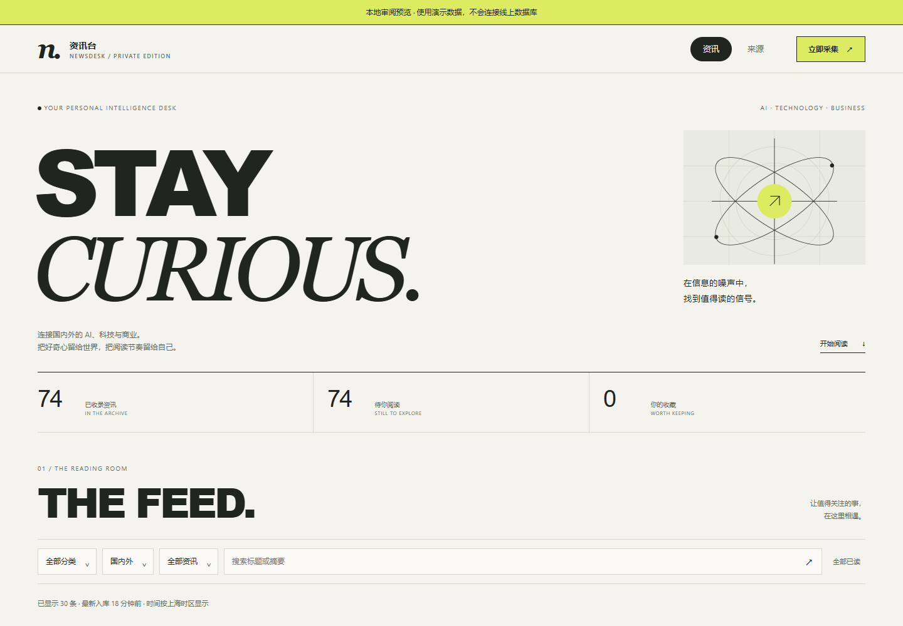

# 工匠的 GitHub 工坊

做 AI 产品与工作流的设计型开发者。

人工智能专业大一。Python 的 class（类）与基础仍在巩固，尚未完成。这个仓库是公开作品集的静态站点。

当前版本为 `1.1.0`，已由本人于 2026-11-10 确认同步到 GitHub。以提交 `643740a76b210917c961261b202cbf314d09d93b` 为基准，保留「做 AI 产品，也做工作流。」的定位、五项精选和明确的演示/原型说明，结合 Motion Design 的开场、模块 reveal 与交互反馈。公开作品集：[jjh-python667.github.io](https://jjh-python667.github.io/)。改动与验收范围见 [REVIEW-NOTES.md](REVIEW-NOTES.md)。



## 这个站点做什么

- 明暗主题，可随系统或手动切换
- 本地 GSAP 开场和滚动编排，并尊重「减少动态效果」
- 作品搜索和按标签筛选
- 项目介绍页，以及学习空间里的固定交互示例
- 构建后由 GitHub Pages 提供 `docs/` 目录

## 技术

| 部分 | 选择 |
| --- | --- |
| 页面 | 手写 HTML、CSS、JavaScript |
| 构建 | Node.js 20 或更新版本，没有 npm 依赖 |
| 动效 | 仓库内的 GSAP 3.15.1 与 ScrollTrigger |
| 发布 | GitHub Pages，静态目录 `docs/` |
| 资讯台 | 独立仓库，Cloudflare Workers + D1 |

## 怎么在本地打开

```sh
npm run build
npm run preview
```

默认地址是 http://127.0.0.1:4176/ 。换端口可以运行 `node scripts/preview.mjs --port 4178`。

源文件在 `site/`，构建脚本在 `scripts/`。改完页面后执行 `npm run build` 本机预览；`npm run prepare:pages` 会构建并将产物同步到 `docs/`、保留 `.nojekyll`，不会提交、推送或部署。`npm run sync` 会重新读取公开 GitHub 仓库动态；失败时保留上一次成功的快照。它会改页面里的动态内容，日常改样式时不必运行。

小预览已随源码保存，日常构建无需 Python。维护缩略图时可安装 Pillow 后运行 `node scripts/optimize-featured.mjs`；通过 `FEATURED_PYTHON` 指定 Python 可执行文件。原始产品截图保持不变。

## 现在做到哪一步

| 已核对 | 还没有 |
| --- | --- |
| 本仓库只发布静态展示页 | 不是线上产品后台 |
| 案头是本地单用户办公助手，截图来自真实本地演示，没有公网 Agent 后端 | 真实云端联调和 Office 应用内验收 |
| 学习搭子公开版本为 v0.4.0；本站学习空间是说明和固定示例 | 真实学习后台、账户和数据库不在本仓库 |
| 资讯台使用 Cloudflare Workers + D1；作品页展示介绍和本地演示截图 | 私人实例需要本人登录，没有对外开放的阅读账户 |
| Python 课仍在巩固 | 课程还没有学完 |

项目页会标明参考来源和 AI 辅助开发的范围。

`jjhbuilds.com` 的现有源码、备案进度、域名解析和服务端部署配置，不因这次 GitHub Pages 发布而改动。GSAP 与 ScrollTrigger 的来源和许可见 `site/assets/vendor/gsap/`。

## 下一步

- 继续巩固 Python
- 学习 C、C++、算法和 NumPy
- 等备案和域名准备好之后，再考虑把作品集放到 jjhbuilds.com

## 相关项目

| 项目 | 是什么 | 仓库 | 作品页 |
| --- | --- | --- | --- |
| 案头 ANTOU | 本地办公助手 | [antou-office-agent](https://github.com/jjh-python667/antou-office-agent) | [介绍](https://jjh-python667.github.io/projects/antou-office-agent.html) |
| 学习搭子 | 个人学习 Agent，v0.4.0 | [personal-learning-agent](https://github.com/jjh-python667/personal-learning-agent) | [介绍](https://jjh-python667.github.io/projects/personal-learning-agent.html) |
| 资讯台 Newsdesk | Cloudflare Workers + D1 的个人资讯台 | [newsdesk](https://github.com/jjh-python667/newsdesk) | [介绍](https://jjh-python667.github.io/projects/newsdesk.html) |
| AI 工具工作流笔记 | 概念笔记，不是产品源码 | [grokbot-workflow-notes](https://github.com/jjh-python667/grokbot-workflow-notes) | [介绍](https://jjh-python667.github.io/projects/grokbot-workflow-notes.html) |
| 星球大战 mini | Python / Pygame 入门练习 | [star-wars-mini](https://github.com/jjh-python667/star-wars-mini) | [介绍](https://jjh-python667.github.io/projects/star-wars-mini.html) |
| 作品集 | 本仓库 | [jjh-python667.github.io](https://github.com/jjh-python667/jjh-python667.github.io) | [线上站点](https://jjh-python667.github.io/) |
